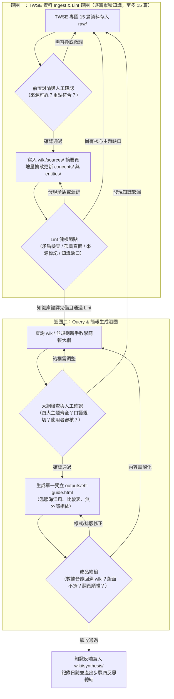

# ETF 官方權威投資百科與教學網頁簡報 — Agent 規範書 (`agent.md`)

> **架構宣言**：本專案嚴格依據 **Andrej Karpathy 所提出之 LLM Wiki 設計模式**（A Pattern for Building Personal Knowledge Bases using LLMs）建構。  
> **權威來源定位**：本知識庫專注以 **臺灣證券交易所（TWSE）官方 ETF 專區**（官網導覽：產品與服務 ➔ 上市證券種類 ➔ ETF；官方總覽：`https://www.twse.com.tw/zh/page/ETF/intro.html`；e添富整合平台：`https://www.twse.com.tw/zh/ETFortune/`）為唯一事實基準。  
> 核心理念：**LLM Wiki 是一個持久存在、具備複利效應的知識程式碼庫（Persistent, Compounding Artifact）**，而非傳統每次查詢皆從零檢索的 RAG。在此模式下，**Obsidian 是 IDE，人工智慧是軟體工程師，Wiki 是程式碼庫，人類負責挑選資料來源、設定方向與探索提問**。

---

## 一、三層架構設計（Three-Layer Architecture）

依循 Karpathy 的架構原則，本專案將資訊劃分為嚴格的三層：

1. **第一層：原始來源（Raw Sources）— 真實世界的唯一基準（不可篡改，Immutable）**
   * **`raw/`**：存放下載整理自臺灣證券交易所（TWSE）ETF 專區的 15 篇官方核心檔案：
     1. `01_TWSE_ETF總覽與基本特性.md`（基本定義、法律全名、兼具股票與基金特性、被動管理理念）
     2. `02_TWSE_ETF雙市場機制與申購買回.md`（初級市場實物/現金申購贖回、授權參與者 AP、次級市場撮合）
     3. `03_TWSE_ETF雙價格體系與淨值市價計算.md`（淨值 NAV 每日結算、盤中 iNAV 即時推算頻率、市價撮合）
     4. `04_TWSE_ETF折溢價公式與市場警示標準.md`（折溢價定義與公式、±0.5% 常態、3% 紅底警示、5% 高風險）
     5. `05_TWSE_ETF商品架構三大主軸.md`（證信託 ETF、期貨信託 ETF、跨境上市境外 ETF 發行架構）
     6. `06_TWSE_被動式ETF資產種類劃分.md`（國內成分股、國外成分股、多資產 ETF、債券及固定收益 ETF）
     7. `07_TWSE_高股息與主題型SmartBeta特性.md`（高股息因子、ESG 永續治理、半導體/AI 科技主題型波動週期）
     8. `08_TWSE_槓桿型及反向型ETF特性與適格性.md`（單日倍數追求、震盪複利耗損、轉倉成本、信用戶交易經驗門檻）
     9. `09_TWSE_主動式交易所交易基金新規.md`（亞太資產管理中心政策、經理人主動選股 Alpha、全透明揭露規範）
     10. `10_TWSE_次級市場交易規則與價格級距.md`（交易時間 9:00-13:30、整張 1000 股、升降單位、國內 10% vs 國外無限制）
     11. `11_TWSE_盤中零股與定期定額小額投資制度.md`（盤中零股撮合機制、定期定額申購扣款、券商手續費折讓與低消優惠）
     12. `12_TWSE_ETF稅費制度與租稅優惠條例.md`（證交稅條例第 2 條 0.1% 租稅優惠、債券暫免徵、經紀手續費 0.1425%）
     13. `13_TWSE_ETF主要投資風險與追蹤誤差成因.md`（市場系統性風險、追蹤誤差成因：經理保管費、換股摩擦、現金拖累）
     14. `14_TWSE_受益憑證買賣辦法與暫停交易風控機制.md`（特殊市況無預警休市、造市中斷、申請暫停交易與恢復交易程序）
     15. `15_TWSE_e添富一站式平台與即時資訊查詢實務.md`（e添富平台功能、大數據排行、ETF 篩選器、配息行事曆、MIS 淨值查詢）
   * **`rawpaper/`**：專供存放使用者於對話中隨時提供的 PDF 論文、學術文獻或研究報告。
   * **鐵律**：AI 僅具備讀取權限，**絕對不得修改或竄改原始來源內容與數值**。

2. **第二層：知識庫（The Wiki）— AI 持久編譯與維護的結構化知識庫（The Codebase）**
   * 位於 `wiki/` 目錄，全權由 AI 依規範生成、交叉編譯、建立雙向連結（`[[wikilinks]]`）與持續維護。
   * 包含：來源摘要頁（`sources/`）、核心概念頁（`concepts/`）、商品實體頁（`entities/`）、綜合教學頁（`synthesis/`）、名詞白話對照表、總索引（`index.md`）與依時間遞增的日誌（`log.md`）。

3. **第三層：規範綱領（The Schema）— 即本規範書 (`agent.md`)**
   * 定義 Wiki 結構、分類標準、雙向連結慣例，以及 **Ingest（匯入）、Lint（健檢）、Query/Synthesis（查詢與簡報產出）** 三大操作流程。

---

## 二、工作區與資料夾結構

本專案根目錄為 `c:\Users\qaz69\Antigravity`，結構規劃如下：

```text
Antigravity/
├── agent.md                               # 【Schema】本規範書（TWSE 15 篇專區基準、Karpathy 操作守則與檢查流程）
├── docs/                                  # 【Design System】設計系統與規格書
│   └── 簡報設計系統與規格書.md                # 晨曦暖陽手帳風規範、色彩語義、排版與 Graph 工作流 SOP
├── raw/                                   # 【Layer 1: TWSE 官方只讀來源區，共 15 篇】
│   ├── 01_TWSE_ETF總覽與基本特性.md
│   ├── 02_TWSE_ETF雙市場機制與申購買回.md
│   ├── 03_TWSE_ETF雙價格體系與淨值市價計算.md
│   ├── 04_TWSE_ETF折溢價公式與市場警示標準.md
│   ├── 05_TWSE_ETF商品架構三大主軸.md
│   ├── 06_TWSE_被動式ETF資產種類劃分.md
│   ├── 07_TWSE_高股息與主題型SmartBeta特性.md
│   ├── 08_TWSE_槓桿型及反向型ETF特性與適格性.md
│   ├── 09_TWSE_主動式交易所交易基金新規.md
│   ├── 10_TWSE_次級市場交易規則與價格級距.md
│   ├── 11_TWSE_盤中零股與定期定額小額投資制度.md
│   ├── 12_TWSE_ETF稅費制度與租稅優惠條例.md
│   ├── 13_TWSE_ETF主要投資風險與追蹤誤差成因.md
│   ├── 14_TWSE_受益憑證買賣辦法與暫停交易風控機制.md
│   └── 15_TWSE_e添富一站式平台與即時資訊查詢實務.md
├── rawpaper/                              # 【Layer 1: 論文文獻區】使用者提供的 PDF 論文與學術報告
│   ├── README.md
│   └── ...
├── wiki/                                  # 【Layer 2: LLM Wiki 知識庫區】支援 Obsidian 雙向圖譜
│   ├── index.md                           # 【內容目錄】按來源、概念、實體分類的總索引
│   ├── log.md                             # 【時間日誌】遵循 ## [YYYY-MM-DD] 操作 | 標題 格式
│   ├── 05-新手名詞白話對照表.md              # 全庫統一術語定義
│   ├── sources/                           # 【來源摘要頁】TWSE 15 篇原始資料的專屬結構化總結
│   ├── concepts/                          # 【概念頁】從 TWSE 資料提煉的核心機制
│   ├── entities/                          # 【實體頁】TWSE 代表商品與法規機制檔案
│   └── synthesis/                         # 【綜合產出頁】三方比較表、常見迷思破解與學習地圖
└── outputs/                               # 【產出區】最終教學產品
    └── etf-guide.html                     # 單一獨立、溫暖海洋風的互動式教學 HTML 簡報
```

---

## 三、三大核心操作（The Three Operations）

### 1. Ingest（匯入與增量更新 — 對應作業步驟一）
* **流程**：新來源進入 `raw/` → **與使用者討論核心觀點（「先討論、後生成」）** → 撰寫 `wiki/sources/` 專屬摘要頁 → 提煉知識**增量擴充/修正至多個 `concepts/` 與 `entities/` 頁面**（單篇來源可觸動 5～10 個頁面） → 標註數據來源（`[來源：raw/0X_TWSE_...]`） → 建立雙向交叉連結（`[[概念名稱]]`） → 更新 `wiki/index.md` 與寫入 `wiki/log.md`。

### 2. Lint（知識庫主動健檢 — 對應作業步驟三與步驟四之反思關鍵）
* **執行時機**：每輪 Ingest 完成後、以及生成簡報前主動執行。
* **檢查維度**：
  * **矛盾檢查（Contradictions）**：跨頁數據或法規規定是否有一致性（如國內成分 10% 漲跌幅 vs 國外成分無漲跌幅）。
  * **孤島頁面（Orphan Pages）**：是否有未被任何頁面引用的孤立 Markdown。
  * **未建頁概念（Missing Pages）**：內文中提及頻繁但尚未建立專屬頁面的重要術語。
  * **引用缺失（Missing Citations）**：是否有未註明 `[來源：raw/...]` 的數據或主張。
  * **知識缺口（Data Gaps）**：對照教學四大主題（概念、種類、交易、風險）是否仍有未解盲點。
* **將檢查往前移的設計**：將事實與術語檢查移至 Ingest 階段的 Lint，能徹底防止「將錯誤或過於晦澀的知識帶入簡報生成階段」。

### 3. Query & Synthesis（查詢與簡報產出 — 對應作業步驟二）
* **受限查詢**：嚴格限定只從 `wiki/` 讀取已編譯的知識，不得憑模型幻想補寫。
* **大綱審查**：規劃適合新手的教學敘事大綱，送交使用者確認。
* **生成簡報**：產出單一獨立 `outputs/etf-guide.html`（溫暖明亮大自然海洋風格、流暢翻頁、無外部依賴）。
* **知識反哺（Compounding）**：簡報中產出的優質生活化比喻、比較結構，亦同步回填至 `wiki/synthesis/` 成為長期積累的知識資產。

---

## 四、工作流程圖（Loop / Graph 設計，對應作業步驟三）



---

## 五、日誌與索引規範（Logging & Indexing）

1. **`wiki/index.md`**：內容導向目錄，必須清楚區分：
   * TWSE 原始來源收錄清單（15 篇）
   * 論文與外部報告清單（Papers）
   * 核心概念目錄（Concepts）
   * 商品實體目錄（Entities）
   * 綜合教學與比較目錄（Synthesis）
   * 四大作業主題覆蓋檢核表

2. **`wiki/log.md`**：時間導向日誌，嚴格遵循一致格式，以利程式解析：
   * `## [YYYY-MM-DD] ingest | 檔案標題`
   * `## [YYYY-MM-DD] lint | 健檢項目與修正結果`
   * `## [YYYY-MM-DD] query | 查詢主題與簡報產出`
   * `## [YYYY-MM-DD] reflect | 步驟四問題分析與流程調整反思`

---

## 六、教學 HTML 簡報規格（延續使用者設定，對應作業步驟二）

* **詳細規範書**：請參閱專屬規格書 `docs/簡報設計系統與規格書.md`。
* **檔案形式**：單一獨立檔案 `outputs/臺灣證券交易所ETF新手投資指南.html`（CSS 與 JavaScript 全部內嵌，支援離線點擊直接瀏覽；同步提供別名檔 `outputs/etf-guide.html`）。
* **視覺風格**：**晨曦暖陽手帳風 (Sunlit Amber Morandi Journal)**。採用大地雙色交替（琥珀暖黃與濃郁咖啡），嚴格保留 8 大語義功能色彩（鼠尾草綠、板岩灰藍、珊瑚粉紅、警示暖橘），搭配金屬活頁夾扣環、純向量 SVG 正圓綠色勾號、懸掛縮排清單與清晰放大字級。
* **架構定位**：13 頁完整故事板，涵蓋封面、學習地圖、一籃子優質資產哲學、三方橫向對照表、雙市場與雙價格、折溢價公式與 3% 防呆線、種類全家福、策略型與主動式新規、槓反每日複利耗損警示、盤中零股與定期定額、費用大拆解與 0.1% 租稅優惠、四大迷思破解、e添富平台與 4 步檢核卡。
