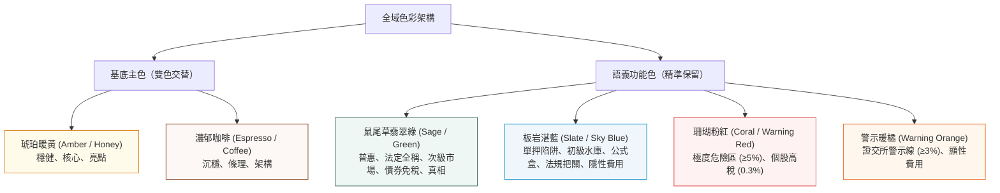
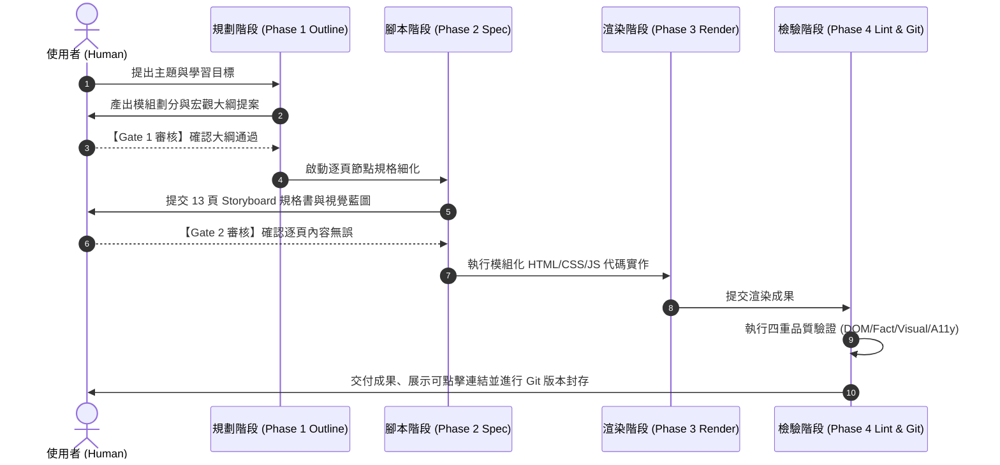

# 臺灣證券交易所 ETF 簡報設計系統與規格書（Presentation Design System & Spec）

> **版本**：v1.0.0  
> **制定日期**：2026-11-15  
> **適用專案**：臺灣證券交易所 (TWSE) 官方知識庫衍生之所有教學簡報與視覺教材  
> **維護依據**：遵循 Andrej Karpathy LLM Wiki 3 層架構規範與 Graph 工作流標準作業程序（SOP）

---

## 1. 風格定位與設計哲學（Design Philosophy）

* **主題風格**：**晨曦暖陽手帳風 (Sunlit Amber Morandi Journal)**。
* **情感定位**：破除傳統金融的生硬冰冷感，營造如同翻開個人日常手帳般溫暖、真實、親近且嚴謹的學習氛圍。
* **內容鐵律**：
  * **100% 依循官方事實驗證**：數據與名詞必須完全引述自臺灣證券交易所（TWSE）官方專區或法規條例，杜絕任何未經證實之幻覺數據。
  * **零海鮮比喻**：全面禁止使用海鮮、魚蝦、火鍋等非官方比喻，回歸客觀資產組合概念。
  * **繁體中文標準**：名詞與術語全數採用臺灣金融市場標準繁體中文（如「投信」、「成分股」、「淨值」、「申贖」）。

---

## 2. 視覺隱喻與容器規範（Visual Containers & Metaphors）

| 視覺組件 | CSS 類別 / HTML 標籤 | 視覺特徵與實作細節 |
| :--- | :--- | :--- |
| **活頁夾裝訂環** | `.binder-rings` & `.ring-element` | 頂部 4 個金屬擬真扣環，帶有微投影與亮面金屬質感，模擬手帳翻頁體驗。 |
| **手帳紙張背景** | `.journal-viewport` | 採用微米白暖調底色（`#fcfaf6`），疊加極微弱橫線條紋筆記紙紋理。 |
| **手帳便籤卡片** | `.memo-card` | 圓角 16px、雙線細邊框、細緻浮動陰影（`rgba(0,0,0,0.04)`）。 |
| **紙膠帶標籤** | `.washi-tape` | 傾斜 -1deg ~ 1deg，左右邊緣採虛線或鋸齒微撕紙邊緣，半透明莫蘭迪純色。 |
| **圖釘與配件** | `.memo-pin` | 單頁圖標**嚴禁重複出現**！每張卡片貼圖僅在標題前出現 1 次（如 📎、🏷️、📌）。 |
| **螢光筆劃記** | `.highlighter-*` | 黃色、藍色、粉色手繪半透明螢光筆底色（`border-radius: 4px; padding: 2px 6px;`）。 |
| **純圓向量勾號** | `<svg>` 向量圖標 | 凡標註真相、成功核取，**一律使用 100% 數學真圓純向量 SVG 正圓翡翠綠徽章**（`<circle cx="12" cy="12" r="10" fill="#16a34a"/><path d="M7 12.3l3.2 3.2 6.8-6.8".../>`），**嚴禁使用系統 emoji 避免變形**。 |

---

## 3. 色彩語意系統（Color Semantics System）

為避免視覺色彩過多造成認知負載，本設計系統採用**「大地暖調雙色交替為基底，保留語義功能色」**之準則：



### 3.1 基底雙色（大地手帳主體）
* **琥珀暖黃 (Light Yellow / Honey Amber)**：
  * 背景：`#fffbeb` ｜ 邊框：`#fde68a` ｜ 標籤：`#d97706` ｜ 標題文字：`#b45309` ｜ 內文：`#78350f`
* **濃郁咖啡 (Espresso / Coffee Walnut)**：
  * 背景：`#fdf8f6` ｜ 邊框：`#e7d5cd` ｜ 標籤：`#78350f` ｜ 標題文字：`#5c2e0b` ｜ 內文：`#451a03`
* **應用場景**：Slide 7（種類）、Slide 8（策略）、Slide 12（迷思）等資訊密集之卡片陣列，採黃、咖規律交替，視覺平靜舒適。

### 3.2 語義功能色（嚴格保留清單）
1. **鼠尾草灰綠（Sage Green `#2d5a4c`, `#eef7f3`, `#b5ded2`）**：
   * Slide 1 封面頂部「🌱 普惠金融・小資新手專屬」紙膠帶。
   * Slide 3 底部「💡 證交所法定全稱」紙膠帶。
   * Slide 5 次級市場散戶撮合卡（`#f0fdf4`, `#bbf7d0`, `#16a34a`）。
   * Slide 6 正常造市區間指標盒（`±0.5%`）。
   * Slide 10 紀律存股卡（定期定額微笑曲線）。
   * Slide 11 債券 ETF 暫免徵證交稅（`0.0%`）。
   * Slide 12 真相純圓向量 SVG 綠色勾號徽章。
   * Slide 13 e添富「配息行事曆」功能卡。
2. **板岩灰藍 / 湛藍（Slate / Sky Blue `#0284c7`, `#0369a1`, `#eff6fc`, `#bae6fd`）**：
   * Slide 3 左側「個股單押陷阱」卡片（`#f0f6fa`, `#2b5c75`, `#20485d`）。
   * Slide 5 初級市場大宗批發水庫卡（`#f0f9ff`, `#0284c7`）。
   * Slide 6 折溢價公式計算盒（深湛藍粗體字 `#034f75`）。
   * Slide 6 溢價收斂虧損說明案例卡。
   * Slide 9 槓反每日複利耗損右側「法規把關」標籤與「風險預告書」螢光筆。
   * Slide 10 集中市場交易時間與撮合規則卡。
   * Slide 11 隱性每日內扣總費用卡。
   * Slide 13 e添富「智慧視覺化篩選」功能卡。
3. **珊瑚陶粉 / 警示紅（Coral Pink / Warning Red `#dc2626`, `#e11d48`, `#fef2f2`, `#fff1f2`）**：
   * Slide 6 極度危險警戒區指標盒（`≥ 5.0%`，`#fef2f2`, `#fca5a5`, `#dc2626`）。
   * Slide 11 一般股票賣出證交稅指標盒（`0.3%`，`#fff1f2`, `#fecdd3`, `#e11d48`）。
4. **警示暖橘（Warning Amber / Orange `#ea580c`, `#c2410c`, `#fff7ed`）**：
   * Slide 6 證交所紅底警示線指標盒（`≥ 3.0%`，`#fff7ed`, `#fdba74`, `#ea580c`）。
   * Slide 11 顯性交易手續費成本卡（`#fff7ed`, `#fed7aa`, `#c2410c`）。

---

## 4. 排版與文字格式規範（Typography & Formatting Rules）

* **字型字級**：
  * 主標題：`1.8rem ~ 2.4rem`，字重 900（黑體/圓體）。
  * 卡片標題：`1.2rem ~ 1.4rem`，字重 900。
  * 核心數值（NAV, Price, iNAV, 百分比）：`1.3rem ~ 1.8rem` 特大字體加粗。
  * 內文正文：`0.96rem ~ 1.05rem`，行高維持 `1.6 ~ 1.7`，嚴禁小於 `0.9rem`。
* **懸掛縮排清單（Hanging Indent List）**：
  * 針對 `ul.indent-list`，第二行文字絕對不可跑到 `•` 下方，必須自動空一格對齊：
    ```css
    .indent-list { list-style: none; padding: 0; margin: 0; }
    .indent-list li { position: relative; padding-left: 1.25em; margin-bottom: 7px; line-height: 1.55; }
    .indent-list li::before { content: "•"; position: absolute; left: 0; top: 0; font-weight: 900; }
    ```
* **避頭尾孤字與換行防呆**：
  * 關鍵詞彙嚴禁被斷字換行（如「資產組合」、「市價平衡」、「雙軌體系」）。
  * 封面印章盒固定一行文字（除「微笑曲線<br>撲滿」按規格換行外，其餘一律 `white-space: nowrap;`）。

---

## 5. Graph 工作流程標準作業程序（Graph-based Deck SOP）

全套投影片製作必須遵循以下四階段與檢核關卡，前一階段未獲確認禁止進入次一階段：



### 檢核驗收標準（Quality Acceptance Checklist）
* [x] **事實一致性**：所有稅率、撮合時間、適格性條件與官方 15 篇文獻一致。
* [x] **DOM 節點完備**：無多餘、重複閉合之 `<section>` 或 `</div>` 標籤。
* [x] **貼圖不重複**：卡片圖釘與標題圖示各司其職，每卡最多 1 個圖釘。
* [x] **色彩精準映射**：基底黃咖雙色交替，保留 8 處語義色彩（鼠尾草綠、板岩藍、粉紅、暖橘）。
* [x] **無障礙與互動**：支援鍵盤方向鍵（←/→/空白鍵）與滑鼠按鈕流暢切換。

---

## 6. Git 版本控制管理規範（Git Management SOP）

專案強制使用 Git 進行版本迭代追蹤：

1. **版本庫結構**：
   * `docs/`：存放本設計系統與各模組規格書。
   * `wiki/`：存放 Karpathy 3 層架構知識庫與時間軸日誌。
   * `raw/`：存放 15 篇 TWSE 官方原始文獻。
   * `outputs/`：存放正式產出之 HTML 簡報檔案。
2. **Commit Message 規範**：
   * `docs: <說明>`：規格書、日誌與文件更新。
   * `feat(slides): <說明>`：投影片內容與功能實作。
   * `style(slides): <說明>`：莫蘭迪色彩調整與版面樣式微調。
   * `fix(lint): <說明>`：DOM 結構標籤修復或文字排版除錯。
